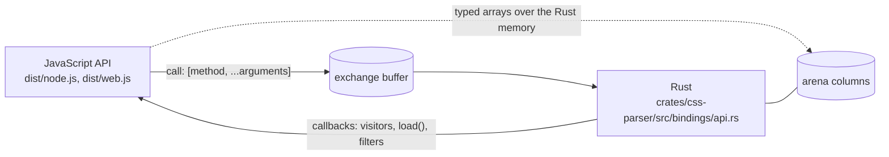

# Bindings: N-API and WebAssembly

The bindings are two packages, built from the extensions of the workspace. Their JavaScript modules (`dist/`) have
the layout of the TypeScript build (`dist/node.js`, `dist/web.js`, `dist/...`) and the same exports. The work is done
by Rust: the N-API addon (`css_parser.node`, crate `extensions/css-parser-napi`) or the WebAssembly module
(`css_parser.wasm`, crate `extensions/css-parser-wasm`). Both crates depend on the library (`crates/css-parser`),
which provides the call interface (`src/bindings/`).

| Package | Entry point | Backend |
|---------|-------------|---------|
| `css-parser-napi` | `dist/node.js` | N-API, Node.js |
| `css-parser-wasm` | `dist/node.js` | WebAssembly, Node.js |
| `css-parser-wasm` | `dist/web.js` | WebAssembly, the browsers |

The JavaScript modules (`bindings/`) are shared; `bindings/core.js` loads the backend of the package (`backend.js` of
the extension directory).

## Build

```shell
$ rustup target add --toolchain stable wasm32-unknown-unknown
$ npm run build        # or npm run build:napi, npm run build:wasm
```

`npm run build` (`build-bindings.sh`) builds the addon and the WebAssembly module, optimizes the WebAssembly module with
`wasm-opt -O3` (binaryen, a dev dependency installed by `npm install`: 16% smaller, 2 to 5% faster), then copies the
JavaScript modules of `bindings/` and the `backend.js` of the extension into `extensions/css-parser-napi/dist/` and
`extensions/css-parser-wasm/dist/`.

## Tests

The specs of the TypeScript project run against both packages (they import `#dist/...`, mapped by the `napi` and
`wasm` conditions of the root package.json):

```shell
$ npm run test:napi   # css-parser-napi in Node.js
$ npm run test:wasm   # css-parser-wasm in Node.js
$ npm run test:web    # css-parser-wasm in Chromium, Firefox and WebKit
$ npm run test:rust   # cargo test --release --workspace
```

## How it works



- **One call interface**: a call (`[method, ...arguments]`) is encoded in an exchange buffer shared by JavaScript and
  Rust (`bindings/runtime.js`, `src/bindings/value.rs`). The same Rust code (`src/bindings/api.rs`) serves the
  N-API addon and the WebAssembly module.
- **No copy of the nodes**: the columns of an arena (`arena.dataTypes`, `arena.firstChild`, ...) are typed arrays over
  the Rust memory. They are created again when the arena grows or when the WebAssembly memory grows.
- **No copy of the output**: with N-API, `result.write` is an external `ArrayBuffer` that owns the Rust buffer. The
  WebAssembly memory cannot be given away: the output is copied once.
- **Lazy evaluation**: `result.code` is decoded when it is read, `AstArenaNode` properties are read from the arena when
  they are accessed, `arena.walk()` and `arena.walkValues()` return one node per Rust call.
- **Callbacks**: the visitors, `load()`, `generateScopedName` and the walker filters are JavaScript functions called
  by Rust. The promises they return are awaited by JavaScript: `parse()` and `transform()` drive the Rust task until
  it completes.
- **Arenas**: an arena created by Rust and returned twice is the same JavaScript object. The Rust arena is released when
  the JavaScript object is garbage collected.
- **Transferable arenas**: `AstArena.toTransferableArenaObject()` copies the columns into JavaScript buffers that can be
  transferred to a worker. An arena that uses JavaScript buffers copies them into Rust around the calls that receive
  it, until it grows.

------
[← Migration to 2.0](./migration.md) | [Rust API →](./rust.md)
